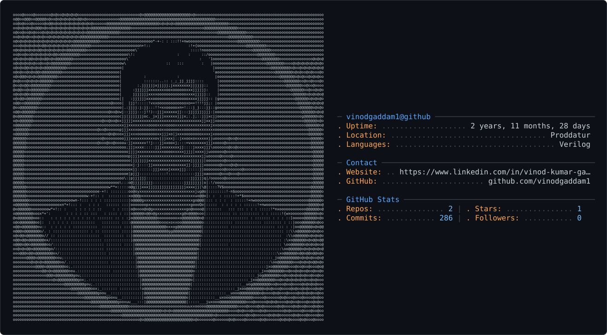

`Verilog` • `SystemVerilog` • `RTL Design` • `Functional Verification` • `UVM` • `formal Verification`

<picture>
  <source media="(prefers-color-scheme: dark)" srcset="dark_mode.svg" />
  <source media="(prefers-color-scheme: light)" srcset="light_mode.svg" />
  
</picture>

## 🔷 About Me

I'm an aspiring **RTL Design & Verification Engineer**, building a strong foundation in **digital logic, Verilog/SystemVerilog, testbench development, and simulation-based functional verification**.

My primary focus is on understanding hardware specifications, implementing RTL, and checking design behavior through simulation and waveform analysis.

- ✍️ Developing **combinational and sequential RTL** using Verilog/SystemVerilog
- 🧩 Working with **FSMs, ALUs, counters, FIFOs, memories, and interface modules**
- ✅ Building **testbenches and self-checking simulations** to validate functionality
- 🌊 Debugging designs through **waveform analysis and expected-versus-actual behavior**
- 🚌 Exploring **UART and APB** design and verification
- 🖥️ Learning **RISC-V architecture** through hands-on processor RTL implementation
- 🐍 Using **Python, Linux, and Git** for engineering workflows
- 📘 Strengthening my knowledge of **SystemVerilog and verification methodology**

## ⚡ RTL Design & Verification Workflow

| Stage | Focus |
|:---:|:---|
| 📋 **Specification** | Understand functionality, interfaces, clocking, and reset behavior |
| 🧠 **Digital Design** | Define combinational logic, sequential behavior, and state transitions |
| ✍️ **RTL Implementation** | Write readable, synthesizable Verilog/SystemVerilog |
| 🧪 **Testbench Development** | Generate stimulus and define expected behavior |
| ▶️ **Simulation** | Run functional simulations using ModelSim / EDA Playground |
| ✅ **Functional Verification** | Check outputs, state transitions, and relevant corner cases |
| 🌊 **Debugging** | Analyze waveforms, identify mismatches, and refine the design |

## 🛠️ Technical Skills

<b>🔹 RTL Design</b>

<b>🔹 Functional Verification</b>

<b>🔹 Interfaces & Digital Building Blocks</b>

<b>🔹 Simulation & EDA Tools</b>

<b>🔹 Programming & Development Environment</b>

## 🔥 Featured Project — RV32IM RISC-V Core

- 🧩 **32-bit RV32IM RISC-V processor** implemented in **Verilog HDL**
- 🖥️ Hands-on academic project involving **processor RTL implementation**
- 🛠️ Project tool environment included **Cadence NCLaunch, Genus, and Innovus**
- 🏭 Supporting implementation work included an **RTL-to-GDSII flow targeting 7-nm technology**
- 📄 Published as an **IEEE research paper**

**📚 Publication:**  
[Design and Physical Implementation of an RV32IM RISC-V Core in 7-nm Technology Using Cadence EDA Flow](https://ieeexplore.ieee.org/abstract/document/11559546)

## 🧮 Project — 32-bit Parameterized ALU

### ✍️ RTL Design
- Parameterized ALU implemented in **Verilog HDL**
- Arithmetic operations: **addition, subtraction, and multiplication**
- Logical operations: **AND, OR, XOR, and NOT**
- Comparison operations
- Logical and arithmetic shift operations

### ✅ Verification
- **Self-checking Verilog testbench**
- Simulation-based checking of ALU functionality
- Waveform analysis and debugging
- Expected-versus-actual output checks

## 📁 Other RTL Design & Verification Projects

| Project | RTL Design Focus | Verification Focus |
|:---|:---|:---|
| 🔌 **UART** | Transmitter and receiver modules | Testbench-based functional checks |
| 🔁 **FSMs** | State-machine modeling and transition logic | Simulation of state transitions |
| 🔢 **Counters** | Parameterized synchronous/asynchronous counters | Counting behavior verified through simulation |
| 📥 **FIFO** | Buffer, read/write pointers, and status flags | Pointer behavior and flag-condition checks |
| 🧠 **RAM / Memory** | RTL memory modules | Read/write functional verification |
| 🚌 **APB-based Memory** | APB interface connected to memory blocks | Testbench-based interface and memory checks |
| ⏰ **Clock / Frequency Generation** | Clock division and frequency-generation modules | Output behavior verified through simulation |

## 🎯 Currently Learning

- 📘 **SystemVerilog** — advanced constructs and verification features
- ✍️ **Advanced RTL design** — improving structure, readability, and parameterization
- ✅ **Functional verification methodology**
- 🔁 **FIFO and CDC** — Clock Domain Crossing concepts
- 🚌 **APB and UART** — deeper protocol understanding
- 🖥️ **RISC-V architecture and processor RTL**
- 🧪 **UVM fundamentals** — currently at the learning stage

## 🌱 RTL Design & Verification Learning Journey

`Digital Logic` → `Verilog` → `RTL Design` → `FSMs` → `Memory & FIFO` → `UART & APB` → `Testbenches` → `SystemVerilog` → `Functional Verification`

This represents a **progressive learning path**, not claimed professional experience. My skills are being developed through **coursework, self-study, academic projects, and hands-on simulation**.

## 🧠 Engineering Mindset

- 📋 **Understand the specification before writing RTL.**
- ✍️ Write clear, readable, and synthesizable code.
- ⏱️ Make clocking, reset behavior, and sequential timing explicit.
- ✅ Verify functionality—not just successful compilation.
- 🌊 Debug using waveform evidence.
- 🎯 Consider corner cases and unexpected input sequences.
- 🔍 Compare actual behavior against expected behavior.
- 🤖 Use AI as an assistant, not as a replacement for hardware understanding.

## 🤖 AI-Assisted Engineering

I use AI tools to support **learning, documentation, debugging assistance, and engineering workflows**.

AI-generated suggestions are not proof of correctness. I rely on **simulation, waveform analysis, and hardware reasoning** to understand and validate RTL behavior.

## 🏭 Supporting ASIC Flow Experience

My primary focus is **RTL Design and Functional Verification**. Academic projects and workshops have also provided hands-on exposure to:

- 🔧 **Synthesis using Cadence Genus**
- 🏗️ **Physical-design flow using Cadence Innovus**
- 📦 **RTL-to-GDSII implementation**

This background helps me understand how RTL connects to downstream implementation, while I continue strengthening my design and verification fundamentals.

## 📊 GitHub Stats

## 🎓 Education

**B.Tech — Electronics and Communication Engineering**  
Madanapalle Institute of Technology & Science (MITS), Deemed to be University  
`2022 – 2026` | **CGPA: 8.19/10**

## 📜 Certifications

- 🔬 **VLSI SoC Design using Verilog HDL** — Maven Silicon, 2025
- ⚡ **VLSI Training** — NIELIT, 2025
- 🏗️ **Physical Design (RTL-to-GDSII) Workshop** — KT Semicon, 2026
- 💻 **Introduction to Microprocessors** — edX
- 🐍 **Python for Beginners** — Simplilearn

### 🤝 Let's design and verify reliable digital hardware.

**RTL Design • Functional Verification • Continuous Learning**

